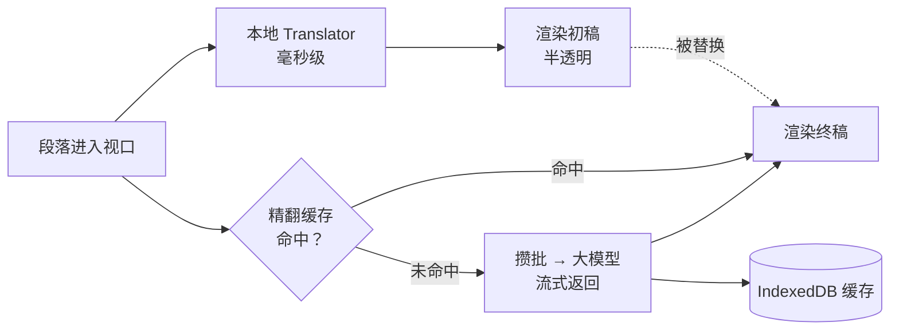

<div align="center">


# 沉浸翻译 Immersive Translator

**又快又准的英文网页双语翻译 Chrome 插件**

本地模型毫秒级出初稿，大模型后台流式精翻替换 —— 一键切换原文 / 双语 / 只看译文

[](https://www.google.com/chrome/)
[](https://developer.chrome.com/docs/extensions/develop/migrate/what-is-mv3)
[](https://www.typescriptlang.org/)
[](https://wxt.dev/)
[](#-开发)
[](#-开发)
[](LICENSE)

[快速开始](#-快速开始) · [使用方法](#️-使用方法) · [配置大模型](#️-配置大模型) · [常见问题](#-常见问题) · [开发](#-开发) · [路线图](#️-路线图)

</div>

---

## 📖 简介

市面上的沉浸式翻译插件大多依赖在线翻译接口：长页面要排队、免费通道会限流、大模型要等整批生成完才显示。**沉浸翻译**换了一种思路：

- **先用本地模型秒出初稿**：调用 Chrome 内置的离线翻译模型，不联网、不排队，眼前这一屏几乎立刻出现译文；
- **再用大模型精翻替换**：多段打包成一个请求，流式返回，每译完一段就立刻替换初稿；
- **只翻你正在看的地方**：优先翻译当前屏幕，并提前预取下一屏，往下滚时译文基本已经就绪。

> [!NOTE]
> 这是一个自用项目，目前只支持 **英文 → 简体中文**，只支持 **Chrome 138+**。

## ✨ 特性

| | 特性 | 说明 |
|:-:|---|---|
| ⚡ | **双引擎接力** | Chrome 内置 Translator 出初稿（半透明），大模型精翻后替换为终稿（不透明） |
| 👀 | **视口优先** | `IntersectionObserver` 只翻可见区域并预取下一屏，长页面不卡顿 |
| 🌊 | **流式回填** | 大模型每生成完一段立刻回填，不必等整批结束 |
| 🔀 | **三种模式** | 原文 / 双语对照 / 只看译文，切换瞬间完成，不重复翻译；只看译文原地替换文字，不破坏网页布局和表单 |
| 🎈 | **侧边悬浮球** | 页面右侧贴边的小球，单击开关翻译，悬停展开菜单，可上下拖动 |
| 🖱️ | **右键菜单** | 页面右键「沉浸翻译」子菜单：开关、切换模式、本站设置一步到位 |
| ♻️ | **本地缓存** | 精翻结果存入 IndexedDB，重复内容和二次访问零请求 |
| 📜 | **动态内容** | 监听 DOM 变化，Twitter / Reddit 等无限滚动的新内容自动翻译 |
| 🧠 | **智能分段** | 按网页实际渲染效果切分段落（菜单项、徽章各自翻译）；自动跳过代码块、已是中文的段落、纯链接、过短文本和 NEW / FREE 这类全大写徽章 |
| 🔌 | **任意大模型** | 兼容所有 OpenAI 格式接口：DeepSeek、通义千问、OpenRouter、Groq、中转站… |
| 🔒 | **隐私友好** | API Key 只保存在本机，只在后台请求时使用；不配置大模型也能纯本地离线使用 |

## 🧠 工作原理



每个段落都有质量等级 `初稿 < 终稿`，**只升不降**：不管缓存、本地引擎、大模型哪个先返回，都不会出现终稿被初稿覆盖的情况。

<details>
<summary><b>架构细节</b></summary>

<br/>

| 位置 | 模块 | 职责 |
|---|---|---|
| 内容脚本 | `scanner` | 找出可翻译段落，支持行内结构与嵌套块 |
| | `text-filter` | 判断段落是否值得翻译、页面是否为英文 |
| | `local-engine` | 封装 Chrome 内置 Translator API |
| | `renderer` | 插入译文、维护质量等级、切换显示模式 |
| | `controller` | 编排：视口优先、双引擎、动态内容 |
| 后台 Service Worker | `port-handler` | 查缓存 → 去重 → 攒批 → 回推结果 |
| | `llm-client` + `stream-parser` | OpenAI 兼容流式请求与「[编号] 译文」解析 |
| | `batching` | 攒批器（20 段 / 2500 字符 / 150ms）+ 全局并发上限 3 |
| | `cache` | 基于 IndexedDB 的精翻缓存 |

完整设计见 [设计文档](docs/superpowers/specs/2026-10-18-immersive-translator-design.md)。

</details>

## 🚀 快速开始

### 1. 获取插件

**方式 A：下载打包好的版本（推荐）**

到 [Releases](../../releases) 下载最新的 `immersive-translator-*-chrome.zip`，解压到任意文件夹。

**方式 B：从源码构建**

```bash
git clone https://github.com/LordVibeCoding/immersive-translator.git
cd immersive-translator
pnpm install
pnpm build        # 产物在 .output/chrome-mv3
```

### 2. 安装到 Chrome

1. 地址栏打开 `chrome://extensions`
2. 打开右上角的 **开发者模式**
3. 点击 **加载已解压的扩展程序**，选择上一步的文件夹（解压目录或 `.output/chrome-mv3`）

### 3. 下载本地翻译模型（只需一次）

点击工具栏上的插件图标 → **下载本地翻译模型**，等待状态变为「✅ 已就绪」。

### 4. 配置大模型（可选，强烈推荐）

插件图标 → **设置**，填写接口地址、API Key、模型名，点击 **测试连接**。不配置的话只使用本地翻译。

> [!IMPORTANT]
> **每个网站第一次打开时，需要在页面上点击一下（或按任意键），本地初稿才会出现。**
> 这是 Chrome 的隐私保护机制：本地翻译是否可用按网站分别报告，创建翻译器需要用户在该页面上的一次操作。点过之后该网站就不再需要；在此之前大模型精翻照常工作。

## ⌨️ 使用方法

打开任意英文网页会**自动翻译**（可在设置中关闭，或在弹窗中把当前网站加入「本站不自动翻译」）。

| 操作 | Windows / Linux | macOS |
|---|:-:|:-:|
| 开关当前页翻译 | <kbd>Alt</kbd> + <kbd>A</kbd> | <kbd>Option</kbd> + <kbd>A</kbd> |
| 双语对照 ⇄ 只看译文 | <kbd>Alt</kbd> + <kbd>S</kbd> | <kbd>Option</kbd> + <kbd>S</kbd> |

快捷键可以在 `chrome://extensions/shortcuts` 自定义。每个标签页的开关和模式**互相独立**，只作用于当前页面；最近一次选择的模式会作为新打开页面的默认模式。在未开启翻译的页面上切换模式，会同时开启该页翻译。

**怎么看译文状态：**

| 外观 | 含义 |
|---|---|
| 半透明译文 | 本地模型的初稿，大模型精翻中 |
| 正常颜色译文 | 大模型精翻完成（或未配置大模型时的本地终稿） |

**三种操作入口，随手可用：**

| 入口 | 能做什么 |
|---|---|
| 🎈 **页面右侧悬浮球** | 单击 = 开/关翻译；鼠标悬停展开菜单：切换模式、本站不自动翻译、本站隐藏悬浮球；按住可上下拖动，位置会记住 |
| 🖱️ **网页右键菜单** | 「沉浸翻译」子菜单：开启/关闭翻译、切换双语/只看译文、本站不自动翻译、本站显示/隐藏悬浮球 |
| 🧩 **工具栏弹窗** | 开关翻译 · 切换模式 · 本站不自动翻译 · 本地模型状态与下载 · 大模型状态与最近一次错误 |

> [!TIP]
> 在某个网站隐藏了悬浮球后，想找回来：页面右键 →「沉浸翻译」→「本站显示 / 隐藏悬浮球」。

## ⚙️ 配置大模型

任何兼容 OpenAI `/chat/completions` 流式接口的服务都可以使用。接口地址填到 `/v1` 为止，插件会自动拼上 `/chat/completions`。

| 服务 | 接口地址 | 模型示例 |
|---|---|---|
| DeepSeek | `https://api.deepseek.com/v1` | `deepseek-chat` |
| 通义千问（阿里云百炼） | `https://dashscope.aliyuncs.com/compatible-mode/v1` | `qwen-turbo` |
| 硅基流动 | `https://api.siliconflow.cn/v1` | 以平台模型列表为准 |
| OpenRouter | `https://openrouter.ai/api/v1` | 以平台模型列表为准 |
| Groq | `https://api.groq.com/openai/v1` | 以平台模型列表为准 |

> [!TIP]
> 精翻体验主要取决于模型的**输出速度**，优先选择响应快的小模型，不需要推理型模型。

## ❓ 常见问题

<details>
<summary><b>为什么本地初稿没有出现？</b></summary>

<br/>

1. 确认已在弹窗中下载本地翻译模型；
2. 每个网站首次需要在页面上**点击一下**才会启用本地翻译；
3. 在网页控制台执行 `'Translator' in self`：若为 `false`，说明当前设备或 Chrome 版本不支持内置翻译，此时只能使用大模型精翻。

</details>

<details>
<summary><b>React / Next.js 网站（如 OpenSea）翻译慢一点？</b></summary>

<br/>

这类网站先由服务端输出页面、再由 React 接管。为避免在接管前改动页面导致网站报错，插件会等页面加载完成、浏览器空闲后再开始翻译（通常 1～2 秒），悬浮球也会稍晚出现。普通网站不受影响，打开即翻译。

</details>

<details>
<summary><b>为什么只支持 Chrome？</b></summary>

<br/>

本地初稿依赖 Chrome 138+ 内置的 [Translator API](https://developer.chrome.com/docs/ai/translator-api)。Edge、Arc 等其他 Chromium 浏览器不一定提供该接口。

</details>

<details>
<summary><b>我的 API Key 安全吗？</b></summary>

<br/>

API Key 只保存在本机的 `chrome.storage.local` 中，只由插件后台在请求大模型时使用，网页脚本无法读取；不会上传到任何第三方服务器。译文一律以纯文本写入页面，不会执行任何 HTML。

</details>

<details>
<summary><b>快捷键没反应？</b></summary>

<br/>

可能与其他插件或系统快捷键冲突，到 `chrome://extensions/shortcuts` 重新设置即可。浏览器内部页面（如 `chrome://` 开头的页面）不支持翻译。

</details>

<details>
<summary><b>精翻报错怎么排查？</b></summary>

<br/>

打开插件弹窗，「大模型精翻」下方会显示最近一次错误；也可以在设置页点击 **测试连接** 查看接口返回的具体信息。

</details>

## 🛠 开发

**技术栈：** TypeScript · [WXT](https://wxt.dev/) · Vitest + happy-dom · Playwright · idb-keyval

```bash
pnpm install                          # 安装依赖
pnpm dev                              # 开发模式，监听文件变更自动重新构建
pnpm build                            # 生产构建 → .output/chrome-mv3
pnpm zip                              # 打包成 zip，用于发布
pnpm local                            # 构建并同步到固定目录（默认 ~/Chrome插件/沉浸翻译，可传参数或写入 .install-dir）
pnpm compile                          # TypeScript 类型检查
pnpm test                             # 单元与集成测试
pnpm test:coverage                    # 测试覆盖率
pnpm exec playwright install chromium # 首次运行 E2E 前执行一次
pnpm test:e2e                         # 端到端测试（使用模拟大模型）
```

> [!NOTE]
> `pnpm dev` 的产物在 `.output/chrome-mv3-dev`。正版 Chrome 不支持通过命令行加载扩展，请在 `chrome://extensions` 中手动加载该目录。

<details>
<summary><b>目录结构</b></summary>

```
.
├── entrypoints/
│   ├── background.ts        # 后台：长连接、快捷键
│   ├── content.ts           # 内容脚本入口
│   ├── popup/               # 工具栏弹窗
│   └── options/             # 设置页
├── src/
│   ├── shared/              # 常量、设置、消息协议
│   ├── content/             # 段落扫描、过滤、渲染、本地引擎、编排
│   └── background/          # 大模型客户端、流式解析、攒批、缓存
├── tests/                   # 单元与集成测试（镜像 src 结构）
├── e2e/                     # Playwright 端到端测试与模拟大模型服务
└── docs/                    # 设计文档与实施计划
```

</details>

## 🗺️ 路线图

- [x] 双引擎接力（本地初稿 + 大模型精翻）
- [x] 视口优先、流式回填、IndexedDB 缓存
- [x] 原文 / 双语 / 只看译文 三种模式与快捷键
- [x] 动态内容（无限滚动）支持
- [x] 本地翻译启用手势更健壮（忽略不产生用户激活的按键）
- [ ] 大模型超时改为「空闲超时」，适配慢速模型
- [ ] 保留行内元素之间的空格
- [ ] 缓存版本号与「清空缓存」按钮
- [ ] 译文保留段内链接与加粗
- [ ] 划词翻译、更多语言方向

## ⚠️ 已知限制

- 仅支持英文 → 简体中文，仅支持 Chrome 138+
- 每个网站首次需要在页面上点击一次才会启用本地初稿
- 译文不保留段内链接、加粗等格式（双语模式下可点击原文链接）
- 精翻缓存不会自动清理

## 📄 许可证

[MIT](LICENSE) © 2026 LordVibeCoding
